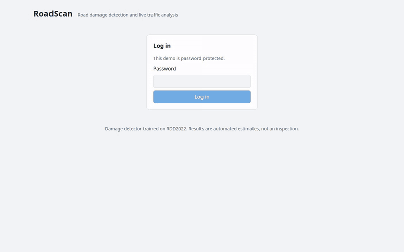
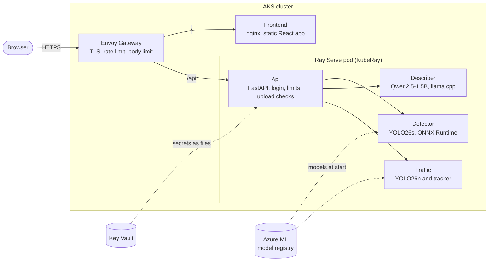
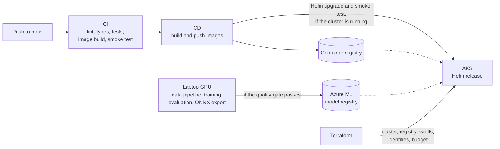

# RoadScan

[](https://github.com/KianRK/infrastructai/actions/workflows/ci.yml)

End-to-end road damage analysis: upload a road photo, an object detector trained on
RDD2022 localises the damage, and a small self-hosted language model describes it. A
second page shows two traffic videos that the server analyses like camera feeds: road
users are detected, tracked and counted while you watch. Trained on a laptop GPU, served
with Ray Serve on Azure Kubernetes Service, provisioned with Terraform and deployed by
GitHub Actions.



*Recorded against a local run with the real models; the wait for the analysis is
shortened. Photo: RDD2022 (CC BY 4.0); videos: Wikimedia Commons, credited under
[Live traffic](#live-traffic).*

**Live demo:** <https://roadscan-8oui0.swedencentral.cloudapp.azure.com>

The deployment on Azure runs on demand and is normally switched off, so the link only
answers while a demo is running; the recording above shows what it serves. Access needs
the demo password, which I share on request.

**Contents:** [Overview](#overview) · [Architecture](#architecture) ·
[Technology choices](#technology-choices) · [Repository layout](#repository-layout) ·
[Local setup](#local-setup) · [Data pipeline](#data-pipeline) · [Training](#training) ·
[Model card](#model-card) · [Serving](#serving) · [Live traffic](#live-traffic) ·
[Frontend](#frontend) · [Containers](#containers) · [Deployment](#deployment) ·
[Security](#security) · [Limitations](#limitations) · [Licences](#licences)

## Overview

1. A user logs in with a shared demo password and uploads a photo of a road.
2. A YOLO26s detector, fine-tuned on RDD2022, marks four kinds of damage: longitudinal
   cracks (D00), transverse cracks (D10), alligator cracks (D20) and potholes (D40).
3. A small language model (Qwen2.5-1.5B) writes an assessment. It never sees the photo,
   only a summary of the detections and curated notes on the detected damage types, and
   its answer is checked against the detections before it is returned.
4. The browser shows the photo with boxes, labels and confidences next to the text.
5. On the live-traffic page one shared analysis per video runs on the server; every
   viewer sees the same boxes and counts.

The project is a portfolio piece. Its subject is the path from data to a deployed,
secured and cost-controlled service; the detector's accuracy is secondary and is
reported as measured in the [model card](#model-card).

## Architecture

At run time:



From code to cluster:



- The gateway terminates TLS (Let's Encrypt) and routes `/api` to Ray Serve and
  everything else to the frontend.
- The four Serve deployments run in one Ray pod on a 2-vCPU node; `Api` calls the other
  three through deployment handles.
- Model weights are not in the repository. The detectors are downloaded from the
  registry when the pod starts; the language model and the videos are baked into the
  serving image so that a start does not depend on third-party downloads.
- GitHub Actions logs in to Azure with OIDC; there are no stored credentials.

## Technology choices

| Area | Choice | Why | Not chosen |
| --- | --- | --- | --- |
| Detector | Ultralytics YOLO26s, fine-tuned | Trains in hours on an 8 GB GPU; exports to ONNX with NMS included | A permissively licensed detector (the repository is AGPL-3.0 as a consequence) |
| Inference | ONNX Runtime on CPU | No PyTorch in the serving image; about 0.1 s per photo on two threads | Serving with Ultralytics / PyTorch |
| Language model | Qwen2.5-1.5B-Instruct, 4-bit GGUF, llama.cpp | Apache-2.0, small enough for two CPU threads next to the detectors on an 8 GB node | A hosted LLM API (cost, and the point was self-hosting); a GPU node (no GPU quota on a free trial) |
| Experiment tracking | MLflow, local or Azure ML | Runs, metrics and a model registry with a quality gate in front of it | Committing weights; ad-hoc files |
| Serving | Ray Serve with KubeRay | Independent deployments with their own resources and concurrency, composed in Python | One FastAPI process for everything |
| Frontend | React, TypeScript, Vite | Small typed client; static files behind nginx | Server-rendered pages |
| Ingress | Envoy Gateway (Gateway API), cert-manager | Actively maintained Gateway API implementation; rate limit, body limit and TLS are declared next to the routes | ingress-nginx |
| Packaging | Helm chart | The same manifests with different values locally and on AKS; one release to upgrade or roll back | Kustomize |
| Infrastructure | Terraform (azurerm) | Everything in Azure is reproducible and can be destroyed with one command | Portal or CLI scripts |
| Automatic stop | Logic App with a managed identity and a two-action custom role | Runs in Azure, independent of whoever started the demo; GitHub's scheduler proved too irregular for this | A scheduled GitHub workflow |
| Secrets | Key Vault with the CSI driver and workload identity | No secrets in the repository, images, chart values or environment variables | Kubernetes Secrets |
| CI/CD | GitHub Actions with OIDC | No long-lived cloud credentials | Service-principal secrets |
| Python tooling | uv, ruff, mypy (strict), pytest | Locked, fast, reproducible | |

More detail on the Kubernetes design is in [`deploy/README.md`](deploy/README.md), on the
Azure resources in [`infra/README.md`](infra/README.md).

## Repository layout

| Path | Contents |
|---|---|
| `training/` | RDD2022 data pipeline and detector training (Python package `rdd`) |
| `serving/` | Ray Serve application: API, detector, LLM (Python package `app`) |
| `frontend/` | React + TypeScript + Vite web interface |
| `infra/` | Terraform for Azure: AKS, registry, ML workspace, Key Vault, identities, budget ([details](infra/README.md)) |
| `deploy/` | Helm chart, cluster components, compose gateway ([details](deploy/README.md)) |
| `scripts/` | Deployment and smoke-test scripts |
| `docs/` | The recording shown above |
| `.github/workflows/` | CI (lint, type-check, tests, build, Terraform and Helm checks), CD (images, deployment, smoke test), Demo (start, stop, automatic stop) |

## Local setup

Prerequisites: [uv](https://docs.astral.sh/uv/), Node.js 24, GNU Make; Docker for the
container variant. No GPU and no Azure account are needed to run the application with
dummy models.

```bash
make install   # uv sync for both Python projects (TORCH=cpu for CPU-only PyTorch), npm ci
make check     # lint + type-check + tests, the same steps CI runs
make help      # all targets
```

Fastest way to see it: `make compose-up`, open http://localhost:8080 and log in with
`roadscan-dev`. The detector and the language model are replaced by dummies that return
fixed results; everything else is the real code path. The variants with the real models
are described under [Serving](#serving) and [Containers](#containers).

Optional: `uvx pre-commit install` to run ruff on every commit.

## Data pipeline

The dataset is never committed; it is downloaded to `training/data/` (git-ignored).

```bash
make data-download   # fetches the countries listed in training/configs/data.yaml
make data-prepare    # VOC XML -> YOLO labels, stratified 80/10/10 split, dataset.yaml, stats.json
```

- **Download:** RDD2022 is one 13 GB zip on figshare containing one zip per country. The
  downloader fetches only the configured countries using HTTP range requests, resumes
  interrupted transfers, and verifies each archive's CRC-32. To iterate quickly, reduce
  `countries` in the config (e.g. `China_Drone` is 160 MB).
- **Conversion:** keeps the classes D00, D10, D20, D40 and drops all other labels; boxes are
  clipped to the image and empty boxes removed. Images without damage are kept as background.
- **Split:** RDD2022 publishes labels for its train split only, so that split is divided
  80/10/10 per country with a fixed seed. Images larger than 1280 px are downscaled.

## Training

```bash
make train       # train -> evaluate on the test split -> ONNX export -> quality gate -> register
make mlflow-ui   # inspect runs and the model registry
```

All hyperparameters live in `training/configs/train.yaml` (YOLO26s, 640 px, batch 20, mixed
precision, 100 epochs with early stopping; about 5 GB VRAM at batch 16). Each pipeline execution is one MLflow run with the full config as
parameters, per-epoch training metrics, test-split mAP@0.5, mAP@0.5:0.95 and per-class metrics.

- **Quality gate:** the ONNX model is registered as `roadscan-detector` and given the alias
  `production` only if the configured test metric reaches the threshold. Otherwise the command
  exits with status 2 and nothing is registered.
- **Export:** ONNX with embedded NMS, so the serving image needs only ONNX Runtime.
- **Azure ML registry:** its MLflow endpoint supports neither model aliases nor the
  logged-model API of MLflow 3 (both answer 404). Against an `azureml://` tracking URI the
  pipeline therefore uploads the model as run artifacts, creates the model version from
  them, and stores the alias as the registered-model tag `alias.production`; the serving
  application resolves `models:/roadscan-detector@production` through that tag.
- **Tracking server:** a local SQLite-backed MLflow store by default. Setting
  `MLFLOW_TRACKING_URI` to an Azure ML workspace switches tracking and registry there
  (`uv sync --extra gpu --extra azure`). To register an already trained checkpoint against
  another server without retraining:
  `uv run python -m rdd.pipeline --weights runs/<run>/weights/best.pt`

## Model card

**Road damage detector** (`roadscan-detector`, version 1)

| | |
| --- | --- |
| Architecture | YOLO26s (Ultralytics), initialised from the COCO-pretrained checkpoint, exported to ONNX with NMS |
| Task | Bounding boxes for D00 longitudinal crack, D10 transverse crack, D20 alligator crack, D40 pothole |
| Training data | RDD2022 without Norway: Japan, India, Czech Republic, United States, China (motorbike and drone); 24,178 training, 3,023 validation and 3,023 test images |
| Training run | 10 epochs, batch 24, 640 px, mixed precision, seed 42, on an RTX 4060 Laptop GPU (8 GB) |
| Intended use | Demonstration. Photos taken from a vehicle or on foot, looking along the road |
| Not intended for | Road inspection, maintenance decisions or any safety-relevant use |

Results on the held-out test split (never used for training or model selection):

| | mAP@0.5 | AP@0.5 D00 | D10 | D20 | D40 | mAP@0.5:0.95 | Precision | Recall |
| --- | --- | --- | --- | --- | --- | --- | --- | --- |
| Version 1 | 0.582 | 0.612 | 0.570 | 0.661 | 0.484 | 0.297 | 0.614 | 0.544 |

What to keep in mind:

- **Not comparable with published RDD2022 results.** Norway is left out entirely
  (training, validation and test), and the test split is my own 10 % of the published
  training data, because the official test labels are not public. Norway's images are
  wide survey-vehicle frames of about 3650 x 2044 px in which damage becomes very small
  at 640 px; that kind of imagery is handled worse.
- **A short run.** Version 1 comes from 10 epochs. The committed configuration is the
  one for a full run (100 epochs, batch 20, early stopping), which has not been done yet.
- **The quality gate is provisional.** A model is registered only if test mAP@0.5
  reaches 0.50. That number is a placeholder chosen before the first run, not a
  requirement derived from a use case; it will be set again after the full run.
- **Potholes are the weakest class** (fewest training boxes: 4,807 of 34,938).
- **Low-confidence detections are shown.** The application displays boxes from a
  confidence of 0.25; the text says when the detector is unsure.
- **Bias.** Six countries, mostly daylight and dry roads. Other road surfaces, night,
  rain or snow are not covered. The United States images are street-level imagery from
  a mapping service; the others were recorded for the dataset, from vehicles and, for
  part of China, from a drone.
- Labels other than the four classes (for example D44 white-line blur, D50 manhole
  covers, repairs) were dropped; images without the four classes are kept as background.

**Language model.** Qwen2.5-1.5B-Instruct (Alibaba Cloud, Apache-2.0), quantised to
4 bits (Q4_K_M GGUF), pinned by revision and SHA-256. It is not fine-tuned. Its role is
to phrase facts it is given; the grounding checks are described under
[Serving](#serving). The severity it mentions (low, moderate, high) comes from a rule
in the code based on box size and count; it is not measured and was not validated.
Generation takes 9 to 23 seconds on two CPU threads.

**Traffic detector.** YOLO26n with the published COCO weights (Ultralytics, AGPL-3.0),
not trained or evaluated here. Counts on the live-traffic page are estimates without
ground truth.

## Serving

```bash
make serve-local   # dummy detector and LLM, no weights needed
curl -F file=@road.jpg http://localhost:8000/api/analyze
```

One Ray Serve application with four deployments, composed through deployment handles:
`Api` (FastAPI ingress) -> `Detector` -> `Describer` (LLM), and `Api` -> `Traffic` (see
[Live traffic](#live-traffic)). Backends are selected in the Serve
config file (`serving/config/serve.*.yaml`), which also sets replicas and CPU per deployment.
To run the real models locally, keep `make mlflow-ui` running in one terminal (it serves the
model registry) and start `make serve-models` in another (after `make traffic-model` and
`make media`, see below). The LLM (1.1 GB) is downloaded on first start.

- **Detector:** the ONNX model with the registry alias `production`, run with ONNX Runtime
  on CPU. Pre- and postprocessing (letterbox, mapping boxes back to the photo) is plain
  NumPy; neither PyTorch nor Ultralytics is installed in the serving environment.
- **LLM:** Qwen2.5-1.5B-Instruct (Apache-2.0), 4-bit GGUF via llama.cpp on CPU; vLLM on a
  GPU node is selectable with `llm.backend: vllm`.
- **Grounding:** the LLM never sees the image. It gets an aggregated summary of the
  detections (count, confidence, share of the image, position, a heuristic severity) and the
  curated reference notes (`serving/src/app/knowledge.yaml`) of the detected classes only.
  Its answer is checked: if it names a damage class that was not detected, or fails, a
  deterministic template text is returned instead (`description_source: "template"`); a
  detected class it leaves out is appended from the reference notes. With no detections the
  LLM is not called at all.

The response schema is defined with Pydantic (`serving/src/app/schemas.py`) and committed as
JSON Schema in `serving/contract/`; a contract test fails when the two diverge.

## Live traffic

```bash
make traffic-model   # export the pretrained detector to ONNX and register it (no training)
make media           # download and convert the two videos (needs ffmpeg; 0.4 GB download)
```

The page shows two videos as stand-ins for traffic cameras. Real camera streams were
left out on purpose: the clips are replayed in a loop, and everything behind them works
as it would for a live source.

- **One analysis for all viewers.** The `Traffic` deployment plays each video against
  the wall clock (position = time since start modulo the video length), analyses five
  frames per second and publishes the results. It works only while somebody is watching
  and pauses 20 seconds after the last viewer left. Frames it cannot analyse in time are
  dropped, not queued; the page shows the achieved rate.
- **Detection and tracking.** YOLO26n pretrained on COCO, exported to ONNX (384 x 640,
  NMS included) and run with ONNX Runtime on one CPU thread; only road-user classes are
  reported. A small tracker matches boxes between frames by overlap, which gives each
  object a stable identity and lets it be counted once.
- **Transport.** The browser asks once where the server's clock is, plays the video from
  the API (range requests) 1.5 seconds behind it, and receives the results as
  server-sent events; it draws the result that belongs to the frame on screen. The
  server closes the event stream every two minutes and the browser reconnects, so no
  proxy timeout is involved.
- **Statistics:** objects in view, objects counted since the analysis started and in
  the last minute, per class, and the analysis speed.

Limits: the counts are estimates. There is no ground truth for the videos, and an object
that is hidden for more than three seconds is counted again. The tracker settings
(`serving/src/app/settings.py`) were chosen by looking at these two videos. The
deployment keeps the clock and the counters in memory, so it runs as one replica.

Videos (not in the repository; `serving/media/streams.json` holds the sources and
checksums): "Straßenverkehr in Düsseldorf" by Slick, CC0 1.0, and "Moving vehicles in
Link road, Cuttack, Odisha" by Subhashish Panigrahi, CC BY-SA 3.0 (cropped), both from
Wikimedia Commons.

## Frontend

```bash
make serve-local    # terminal 1: backend with dummy models
make frontend-dev   # terminal 2: http://localhost:5173, password "roadscan-dev"
```

React + TypeScript + Vite. Login screen, image upload with client-side validation (JPEG, PNG,
WebP; 10 MB), the photo with bounding boxes and labels, the written assessment with its
source (language model or template), and loading, error and session-expired states. Boxes use
the API's relative coordinates, so they stay aligned at any display size. The second page
(`#traffic`) shows the two analysed videos with their statistics.

## Containers

```bash
make compose-up          # frontend + backend with dummy models: http://localhost:8080
make smoke-test          # end-to-end check of the running stack
make compose-down

make model-fetch         # once: copy the registered "production" detectors to ./models
make compose-up-models   # the same stack with the real detectors, LLM and traffic videos
```

| Image | Base | Compressed size | Runs as |
| --- | --- | --- | --- |
| `frontend` | `nginx-unprivileged` (Alpine) | 26 MB | uid 101 |
| `serving` | `rayproject/ray` (CPU) | 1.2 GB, 2.3 GB with LLM weights | uid 1000 |
| `training` | `nvidia/cuda:13.0-base` | 3.8 GB (CUDA build of PyTorch) | uid 10001 |

All three are multi-stage builds with base images pinned by digest and Python and npm
dependencies installed from the lockfiles. Build tools (uv, Node) stay in the build stages.

- **Serving** builds on the official Ray image, pinned to the Ray version in `uv.lock`;
  the remaining dependencies are installed from the lockfile into the image's Python
  environment. `sudo`, which the base image grants its user without a password, is
  removed. The LLM weights are fetched at build time, verified against a pinned SHA-256,
  and stored in the image (`--build-arg LLM=none` leaves them out), so a pod start does
  not depend on Hugging Face. A slim Python base with Ray from the lockfile would be
  about a quarter of the size (0.3 GB); the official image was chosen for its tested
  compatibility with KubeRay.
- **Compose** mirrors the cluster layout: a gateway (nginx here, Envoy Gateway on AKS)
  routes `/api` to the Ray Serve application and everything else to the frontend, limits
  the request size, and applies a coarse rate limit in front of the application's own.
  Containers run with all capabilities dropped; frontend and gateway have read-only
  file systems.
- **Frontend** responses carry a Content-Security-Policy (`default-src 'self'`), and
  hashed assets are cached for a year while the app shell is always revalidated.
- **Training** in a container:
  `docker run --rm --gpus all --ipc=host --user "$(id -u):$(id -g)" -v "$PWD/training/data:/app/data" -v "$PWD/training/runs:/app/runs" -e MLFLOW_TRACKING_URI=<server> roadscan-training:local`.
  It runs `rdd.pipeline` by default; append `rdd.download` or `rdd.prepare` for the data
  steps. The tracking server must be reachable from the container: a local SQLite
  registry records host paths and is not usable from inside it.

CI builds the images and runs the smoke test against the compose stack on every pull
request (serving without the LLM weights, training with CPU-only PyTorch).

## Deployment

Three steps, each documented where its code lives:

1. **Azure resources** with Terraform: [`infra/README.md`](infra/README.md). A sizing
   profile `free` fits the 4-vCPU quota of an Azure free trial (two 2-vCPU nodes, no GPU).
2. **Cluster components and the application** with Helm:
   [`deploy/README.md`](deploy/README.md). The chart can also be installed on a local
   minikube cluster.
3. **Continuous deployment**: after CI passes on `main`, the `CD` workflow builds both
   images and pushes them to the registry; if the cluster is running it upgrades the
   Helm release and runs the smoke test against the public URL.

```bash
make infra-plan && make infra-apply                           # 1: Azure resources
make aks-credentials platform-install images-push deploy     # 2: first deployment
make github-setup                                             # 3: values for the workflows

make demo-up      # start the cluster for HOURS=2 and deploy the newest image
make demo-down    # stop it
```

The same start and stop are available as the `Demo` workflow in GitHub ("Run workflow").

**On-demand operation.** The cluster runs only when it is needed. `az aks stop`
deallocates the control plane and the nodes and keeps the cluster's state; node OS disks
are ephemeral, so nothing of the nodes remains while it is stopped. A start writes the
time of the stop into a tag on the cluster, and a Logic App checks that tag every 15
minutes and stops the cluster once the time has passed. A running cluster without the
tag counts as overdue. Budget alerts by e-mail are a second safeguard.

Measured on the `free` profile: a start from the stopped state, including the deployment
and the smoke test, takes about 9 minutes; a stop 2.5 minutes; an image build 9 minutes
without and under 1 minute with the registry cache.

To remove everything: `terraform destroy` in `infra/` (described in
[`infra/README.md`](infra/README.md#destroy); documented, not yet exercised on this
deployment).

## Security

- **Login:** one demo password, compared in constant time. A successful login sets a signed
  session token (JWT, HS256, 60 minutes) in a cookie that is `HttpOnly`, `Secure`,
  `SameSite=Strict` and limited to `/api`. `SameSite=Strict` is the CSRF protection.
- **Secrets:** the password and the signing key are read from files mounted from Azure Key
  Vault (`auth.secrets_dir`), or from `ROADSCAN_DEMO_PASSWORD` / `ROADSCAN_JWT_SECRET` for
  local runs. The API refuses to start without them. Nothing secret is in the repository
  or in an image; the `roadscan-dev` password in the Makefile only exists for local runs.
- **Rate limiting in the application:** login attempts per client address (10 per 5 min),
  analyses per session (6 per min) and per client address (20 per min); `429` with
  `Retry-After`. The client address is taken from `X-Forwarded-For` only as far as our own
  proxies wrote it. A second, coarser limit (120 requests per minute per address) is enforced at
  the gateway.
- **Uploads:** 10 MB limit; file type decided by content (JPEG, PNG, WebP), not by name or
  declared type; pixel count checked from the header before decoding (decompression
  bombs); large photos are decoded at reduced size.
- **Cluster:** the namespace enforces the `restricted` Pod Security Standard (non-root,
  no capabilities, default seccomp profile), no pod mounts a Kubernetes API token, and
  network policies admit traffic to the application only from the gateway.
- **Azure:** the cluster uses Entra ID with Azure RBAC only (local accounts disabled).
  The serving pod's identity can read the two secrets and the model registry; the
  pipeline's identity can push images, operate the cluster, act inside the one
  namespace and read the demo password for the smoke test. Terraform writes the
  generated secrets through write-only arguments, so they are not in its state.

## Limitations

- **Demo-grade model.** See the [model card](#model-card): a short training run, a
  provisional quality gate, no comparison with published results.
- **Severity is a heuristic** in code, not a measurement.
- **One replica by design.** The application's rate limiter and the live-traffic clock
  and counters live in memory; with more than one `Api` or `Traffic` replica they would
  no longer be exact. The gateway's rate limit is independent of that.
- **Logout is stateless.** It clears the cookie; a copied token stays valid until it
  expires (60 minutes). There is one shared password, no user accounts.
- **Downtime during rollouts.** The Ray pod is replaced in place because the node has no
  room for a second one; the API is unavailable while the new pod starts.
- **vLLM backend untested.** `llm.backend: vllm` exists in the code for a GPU node, but
  no GPU image is built and it was never run; the free trial has no GPU quota.
- **`terraform destroy`** is documented but was not exercised.
- **Traffic counts are estimates**; the tracker settings were tuned by eye on the two
  videos.
- **Not verified on AKS:** the live-traffic page in a real browser (it was measured
  through the API there and tested in a browser locally), and the gateway's rate limit
  with several viewers behind one address.
- **Development dependencies:** `npm audit` reports moderate findings in `minimatch`
  through ESLint. They are not part of the shipped frontend; the fix would downgrade
  ESLint.
- **Terraform state is local.** One operator; a remote backend is described as an
  option in `infra/README.md`.

## Licences

| What | Licence | Note |
| --- | --- | --- |
| This repository's code | [AGPL-3.0-or-later](LICENSE) | Follows from training with Ultralytics |
| Ultralytics YOLO, YOLO26s / YOLO26n weights | AGPL-3.0 | The fine-tuned detector is a derivative; weights are not in the repository |
| RDD2022 dataset | CC BY 4.0 | Arya et al., "RDD2022: A multi-national image dataset for automatic Road Damage Detection", 2022 |
| Qwen2.5-1.5B-Instruct | Apache-2.0 | Unmodified weights, quantised GGUF from the publisher |
| Traffic videos | CC0 1.0 and CC BY-SA 3.0 | Credited under [Live traffic](#live-traffic) and on the page; not in the repository |
| Ray, MLflow, FastAPI, ONNX Runtime, llama.cpp, React, Envoy Gateway, cert-manager, KubeRay | Apache-2.0, MIT or BSD | Used as dependencies |

Anyone who offers a modified version of this application as a network service has to
make their source available under the AGPL.
