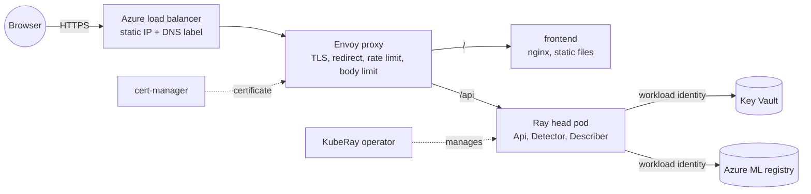

# Deployment (Kubernetes)

| Path | Contents |
| --- | --- |
| `platform/install.sh` | Cluster-wide components at pinned versions: Envoy Gateway, cert-manager, KubeRay operator; plus the gateway class and the `roadscan` namespace. Run once per cluster by a cluster admin. |
| `helm/roadscan/` | The application: Ray Serve (`RayService`), frontend, gateway with TLS, rate limit and body limit, secrets from Key Vault, network policies. Everything in it is namespaced. |
| `compose/` | Gateway configuration of the docker compose stack (see the top-level README). |
| `../scripts/deploy.sh` | `helm upgrade --install` plus the wait and rollout logic; used by `make deploy`, `make deploy-local` and the CD pipeline. |



## Design

- **Helm, not Kustomize.** The same manifests are installed with different inputs (local
  cluster, AKS; host name, registry, identity IDs that only exist after `terraform apply`).
  Those are values, and Helm also validates them at install time (`templates/_helpers.tpl`)
  and gives the pipeline one atomic, versioned release to upgrade or roll back.
- **One Ray pod.** The head pod runs the four Serve deployments; there are no workers. On
  the `free` profile the application node has 2 vCPUs and 8 GB, and the measured memory use
  with both models loaded is 3.6–3.9 GB.
- **Upgrades in place** (`ray.upgrade: InPlace`). KubeRay's default starts a second Ray
  cluster next to the running one and switches over, which needs twice the resources. Here
  KubeRay is told not to do that; when the cluster definition changes (new image, new
  resources), `scripts/deploy.sh` deletes the Ray cluster and KubeRay recreates it. The
  cost is an outage of the API for as long as the pod needs to start. Changes to the
  Serve config alone are applied without a restart. `ray.upgrade: NewCluster` restores the
  zero-downtime behaviour where there is room.
- **Gateway.** One Envoy proxy, configured through the Gateway API: `/api` goes to Ray
  Serve, everything else to the frontend; HTTP is redirected to HTTPS. On the API route a
  per-address rate limit (120 requests per minute, `429`), a body limit (11 MiB, `413`) and
  a request timeout (180 s) are enforced before the application's own limits.
- **Client address.** The load balancer preserves the source address
  (`externalTrafficPolicy: Local`), Envoy appends it to `X-Forwarded-For`, and the
  application trusts exactly that one entry (`trusted_proxy_hops: 1`). Whatever a client
  writes into the header itself is ignored.
- **TLS.** cert-manager obtains a Let's Encrypt certificate with the HTTP-01 challenge,
  answered through the same gateway. The issuer lives in the application namespace.
  `tls.production: false` switches to the staging CA.
- **Secrets.** The demo password and the signing key are mounted as files from Azure Key
  Vault by the Secrets Store CSI driver, with the pod's workload identity. They are neither
  chart values nor Kubernetes Secrets nor environment variables.
- **Pod security.** The namespace enforces the `restricted` Pod Security Standard: all
  containers run as non-root with all capabilities dropped and the default seccomp
  profile; the frontend's file system is read-only. No pod mounts a Kubernetes API token.
- **Network policies.** The frontend accepts connections from the gateway only; the Ray
  pod from the gateway (port 8000), the KubeRay operator and other Ray pods.

## Local cluster

Verifies the chart, the operators and the gateway without Azure. Dummy models, plain HTTP,
secrets from an ordinary Secret. Needs `kubectl`, `helm` 4 and a local cluster.

```bash
minikube start --cpus 4 --memory 6g
make compose-up && make compose-down          # builds roadscan-serving:local and roadscan-frontend:local
minikube image load roadscan-frontend:local
minikube image load roadscan-serving:local

make platform-install
make deploy-local

kubectl -n envoy-gateway-system port-forward \
  "$(kubectl -n envoy-gateway-system get svc -l gateway.envoyproxy.io/owning-gateway-name=roadscan -o name)" 8080:80 &
make smoke-test                               # http://localhost:8080, password roadscan-dev
```

The gateway reports `Programmed: False` on a cluster without a load balancer; the
port-forward works regardless.

## AKS

After `terraform apply` and the model registration (see [`infra/README.md`](../infra/README.md)).
Additionally needs [`kubelogin`](https://azure.github.io/kubelogin/) (`az aks install-cli`),
because the cluster only accepts Entra ID logins.

Both detectors (`roadscan-detector` and `roadscan-traffic`) must be registered in the
Azure ML workspace first ([`infra/README.md`](../infra/README.md), step 2): a deployment
whose model is missing does not start, and the application stays unhealthy.

```bash
make aks-credentials     # kubectl context for the cluster
make platform-install    # once per cluster
make images-push         # build and push both images, tagged with the current commit
make deploy              # Helm release with values from the Terraform outputs

kubectl -n roadscan get gateway,certificate,rayservice,pods
ROADSCAN_DEMO_PASSWORD="$(terraform -chdir=infra output -raw demo_password_command | sh)" \
  make smoke-test URL="https://$(terraform -chdir=infra output -raw hostname)"
```

The first start takes several minutes: the 2.3 GB serving image is pulled, the detector is
downloaded from the registry and the LLM is loaded. The certificate is issued once the
gateway has its public address, usually within two minutes after that.

`values-aks.example.yaml` shows the values `make deploy` derives from Terraform.

## Continuous deployment and the on-demand demo

Two GitHub workflows act on the cluster. Both log in to Azure with GitHub's OIDC token and
a federated credential on a managed identity; there is no client secret, registry password
or kubeconfig in GitHub. `make github-setup` writes the four repository secrets they read
(three identifiers and the Helm values; none is a credential, but the logs of a public
repository are public). Without them the workflows do nothing, e.g. in forks.

| Workflow | Trigger | What it does |
| --- | --- | --- |
| `CD` | CI passed on `main` (or manually) | Builds both images with a layer cache in the registry, pushes them tagged with the commit, and, if the cluster is running, upgrades the Helm release and runs the smoke test against the public URL. If the cluster is stopped, only the images are pushed. |
| `Demo` → start | manually ("Run workflow", hours 1–12) | Starts the cluster, records the time of the automatic stop, deploys the newest image in the registry, runs the smoke test. |
| `Demo` → stop | manually | Stops the cluster. |

The same from a terminal, with your own Azure login:

```bash
make demo-up            # HOURS=2 by default
make demo-status
make demo-down
```

- **What the pipeline identity may do:** push images, operate the cluster resource (start,
  stop, credentials, tags), everything inside the `roadscan` namespace and nothing outside it,
  and read the one Key Vault secret `demo-password` for the smoke test. It cannot read the
  signing key and has no rights on the other Azure resources.
- **Automatic stop.** The stop time is the cluster's Azure tag `demo-stop-at`, written
  before the cluster is started. A Logic App (`infra/autostop.tf`) reads the cluster
  every 15 minutes with its managed identity and stops it once the time has passed; its
  role allows exactly reading and stopping the cluster. A running cluster without the
  tag counts as overdue, so one started with `az aks start` or by `terraform apply` is
  stopped by the next check as well; use `make demo-up` to keep it up. While the
  cluster starts, stops or is updated, the check does nothing. The budget alert remains
  as a second safeguard.
- **After a stop** Azure needs 15–30 minutes before the cluster can be started again.
- **Deployments are serialised:** deploy, start and stop jobs share one concurrency group.

## Verified, and not

Verified on a local minikube cluster (Kubernetes 1.35) with Envoy Gateway 1.10.0,
cert-manager 1.21.3, KubeRay 1.7.2 and Ray 2.59.1: installation, the smoke test through the
gateway (11 checks), `413` for a 12 MB upload, `429` after the rate limit, repeated
`helm upgrade` without changes, and the in-place replacement of the Ray cluster under the
`restricted` Pod Security Standard. Memory was measured with the real models in the docker
compose stack.

Verified on AKS (Kubernetes 1.36, `free` profile, Sweden Central): the certificate was
issued within three minutes of the first deployment, HTTP redirects to HTTPS, and the
smoke test passes over HTTPS, which covers the Key Vault mount, the workload identity and
the model download from Azure ML. Both application pods fit on the one 2-vCPU / 8 GB
node. From a pod in another namespace, connections to the frontend and to Ray Serve time
out, so the network policies are enforced.

Verified in GitHub Actions (2026-11-13): the OIDC login, the image build (about 9 minutes
without and under 1 minute with the registry cache), `Demo` stop, and after a 20-minute
pause `Demo` start: the cluster start, the deployment of a new image and the smoke test
(17 checks, including the live-traffic stream through the gateway) took 9 minutes together.
`CD` against the running cluster deployed and passed the smoke test. With both video
streams analysed, the Ray pod reported 5 analysed frames per second per stream, no dropped
frames and about 50 ms per inference.
